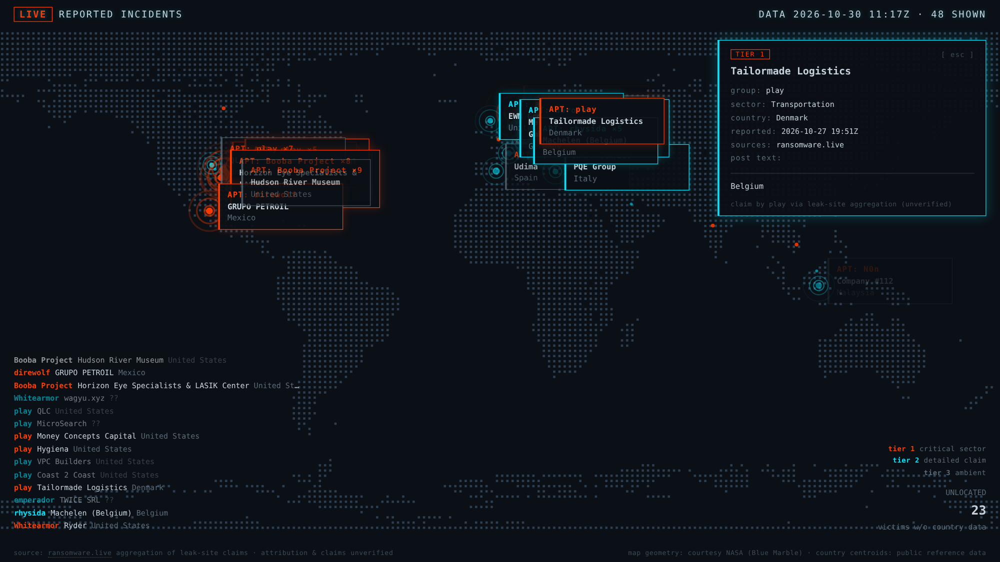

# Gjallarhorn

Zero-egress wall display for ransomware leak-site claims. The page never
touches an external network; corroborate events by bringing a second feed.



Named for Heimdall's horn, the instrument that sounds the warning before
Ragnarök. This is a wall display for a SOC, classroom, or home lab: a world
map where every ransomware crew's claimed victim appears as a ping, with a
rolling log and click-to-inspect detail on every event.

## What this is (and is not)

- **Claims, not verdicts.** Ransomware crews post victims on leak sites as
  pressure tactics. Those posts are *criminal claims*. Gjallarhorn displays
  them as such: unverified, attributed to the crew that made the claim.
- **A display, not a data product.** The page is a pure consumer of its own
  generated files (`web/events.js`, `web/events.json`). It makes zero
  external network requests, enforced by CSP, not by convention.
- **Correlation-aware.** Run a second feed alongside the free primary and
  matching events merge into one corroborated entry; rival claims by
  different crews on the same victim stay separate.

## Quick start

```bash
git clone https://github.com/v0idsnail/gjallarhorn && cd gjallarhorn

# 1) zero-network demo mode (synthetic events, clearly labeled)
python3 ops/fetcher.py --demo

# 2) serve the display (loopback only)
cd web && python3 -m http.server 8377 --bind 127.0.0.1
# open http://127.0.0.1:8377/
```

Windows note: if `python3` is not found, use `py` instead (`py ops\fetcher.py --demo`).

For real data, poll the primary feed (see [Data terms](#data-terms--attribution)
first; they matter):

```bash
# anonymous legacy endpoint: works with no key (personal use, deprecated upstream)
python3 ops/fetcher.py --once

# recommended: free PRO tier; get a key at https://my.ransomware.live
export RANSOMWARE_LIVE_API_KEY="..."   # never commit this; it lives in your env
python3 ops/fetcher.py --once
```

Click any log line, map card, or live ping for the detail overlay. `Esc`,
click-outside, or 30 s idle dismisses it.

## Understanding the display

Two display modes, chosen automatically:

- **Live** (default with real data): the page polls its own `events.json`
  once a minute and spawns pings only for genuinely new events. Nothing
  loops or repeats; every event fires once, its card fades after a few
  seconds, and its location stays on the map as a small dimming marker, so
  the world accumulates a heat-trail of claims. New fetcher output appears
  within about a minute, no reload needed.
- **Replay** (default for `--demo` data, or append `?replay` to the URL):
  the whole snapshot plays as one compressed timeline and loops, so a
  screen always has something moving. This is the demo and clip mode.
  If the page cannot fetch (opened via `file://` or without `events.json`),
   it falls back to replay automatically.

Tiers (also shown in the on-screen legend):

- **Tier 1, red:** critical sector (healthcare, energy, finance, government
  and defense, transportation)
- **Tier 2, cyan:** detailed claim text plus a country
- **Tier 3, dimmed:** ambient volume of the feed

Tiers are a triage heuristic (sector criticality, then claim substance), not
a severity verdict: nobody can have that from a leak-site post.

## The event contract

The entire display consumes one shape. Any producer that emits it works;
this is the extension point, no code changes needed:

```js
window.EVENTS = [ {
  "k":  "8f21c0ffee123456",       // stable dedup key (content hash)
  "g":  "LockBit 3.0",            // crew name (their claim)
  "t":  "Example Corp",           // claimed victim
  "a":  "Manufacturing",          // sector
  "c":  "SE",                     // ISO 3166-1 alpha-2 country ("" = unknown)
  "d":  "crew's own claim text",  // optional description
  "di": "2026-10-28T07:00:00+00:00",  // discovered (ISO 8601)
  "pu": "",                       // published (ISO 8601, "" = unknown)
  "s":  ["ransomware.live"]       // sources that reported it (>1 = corroborated)
} ];
```

## Second sources (bring your own feed)

`ops/fetcher.py` runs additional feeds concurrently with the primary and
correlates them. Configure via `ops/sources.json` (see
`ops/sources.json.example`): HTTPS URL, optional auth header sourced from an
**environment variable** (keys are never written to config, disk artifacts,
or logs), a field map, and a priority.

You are responsible for your feed's terms and your account. Gjallarhorn ships
only the adapter config, never your credentials, never your data.

**Correlation policy:** the merge key canonicalizes group + victim names
(lowercase, punctuation/legal-suffix stripped), so "Acme Inc." and
"acme incorporated" merge. Display fields come from the highest-priority
source with fill-down for blanks; timestamps take the earliest report; `s`
lists every reporting source. Same victim claimed by *different* crews stays
separate events. That is a feature, not a bug.

Generic adapters expect ISO-2 country codes; other country formats are
dropped for that source (another source may fill the gap).

## Deployment
No special hardware is needed. The Raspberry Pi Zero 2 is the smallest
machine Gjallarhorn was designed against: it is the floor, not a requirement,
so any laptop, desktop, or server works. Requirements are Python 3.7 or newer
and any modern browser; nothing else installs.

**Model A, single host (Pi, standalone):** the same box runs the fetcher on
a timer and serves the page to a kiosk browser. Simplest; the host needs
network egress.

**Model B, split:** fetch on any always-on host with egress, serve on the
display host with *zero* external network dependency. Sync `web/events.js`
and `web/events.json` over with scp/Syncthing/rsync; live mode polls the
local web root only, so the display node still talks to nobody.

Poll cadence: **never faster than every 30 minutes.** Ransomware.live caches
its data for 30 minutes, and polling faster is a breach of their fair-use
terms, not just wasted calls. Use a timer with jitter, not a fixed cron.

Companion units (the timer triggers the service; the service runs the fetcher):

```ini
# /etc/systemd/system/gjallarhorn-fetch.service
[Unit]
Description=Gjallarhorn feed fetch

[Service]
Type=oneshot
# export your key here if you use the PRO tier (or use an EnvironmentFile)
ExecStart=/usr/bin/python3 /opt/gjallarhorn/ops/fetcher.py --once

# /etc/systemd/system/gjallarhorn-fetch.timer
[Timer]
OnCalendar=*:0/30
RandomizedDelaySec=300
Persistent=true

[Install]
WantedBy=timers.target
```

A 30-minute cadence uses ~1,440 of your free 500,000 monthly PRO calls. The
limit exists for harvesters, not for walls.

The display targets Raspberry Pi Zero 2 class hardware: the world map is
pre-rendered once to an offscreen canvas, pings are bounded, and the overlay
is event-driven. Nothing in the render loop allocates.

## Security model

The display treats all feed content as hostile input, because it is:

- **Zero external egress, enforced:** `Content-Security-Policy: default-src
  'none'; script-src 'self'; style-src 'self'; connect-src 'self'; img-src
  'none'`. The only network act the page can ever perform is fetching its
  own same-origin `events.json`; it cannot reach any external origin, frame,
  or load remote anything.
- **textContent only:** no `innerHTML`, no `href`/`src`/`style` assignment
  from feed data, ever. Attacker-authored claim text renders inert by
  construction.
- **Sanitized pipeline:** the fetcher strips control/bidi/zero-width
  characters (before and after NFKC), length-caps every field, validates
  timestamps and country codes, and writes pure-ASCII JSON that cannot break
  the JS string-literal context.
- **Fail closed:** on any validation error the existing `events.js` is left
  untouched; the display keeps last-good data instead of going dark or
  rendering garbage. A non-empty response yielding zero valid events is
  treated as an attack, not an accident.
- **Keys in env vars only.** No credential ever reaches a file the repo or
  the web root serves.

## Data terms & attribution

Ransomware.live is an independent project by Julien Mousqueton. Its
[terms](https://www.ransomware.live/t&c) apply to everyone using this tool
with the default feed, and they are reasonable:

- **Attribution with a link** on any display of the data (the built-in
  footer provides it, so keep it).
- **Do not republish raw data** in any form. That is why `web/events.js` and
  `web/events.json` are gitignored and must stay out of forks, screenshots
  aside.
- **Do not re-serve their data as an API** or clone their site's look.
- **No commercial use of the data** without written approval. This repo's
  MIT license covers *code only*; feeding a paid engagement with their data
  needs their sign-off.
- Poll at most every 30 minutes (their cache interval).

## Layout

```
web/    the display: static files only, serve this directory
ops/    fetcher.py, sources.json.example (your real sources.json: gitignored)
docs/   screenshot
```

## Credits

- Data: [ransomware.live](https://www.ransomware.live) by Julien Mousqueton
- Map dot geometry: derived by sampling NASA Blue Marble imagery (public
  domain). Courtesy NASA.
- No affiliation with any of the above.

## License

[MIT](LICENSE) covers code only. Feed data belongs to its sources;
ransomware.live's terms govern use of their data. No victim data ships in
this repository.
